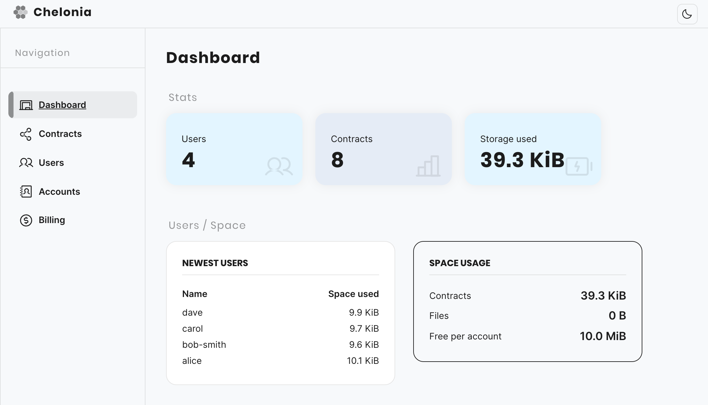

<p align="center">
    <a title="Slack" href="https://join.slack.com/t/okturtles/shared_invite/zt-10jmpfgxj-tXQ1MKW7t8qqdyY6fB7uyQ"></a>
    <a title="Ask DeepWiki" href="https://deepwiki.com/okTurtles/chel"></a>
    <a title="Donate" href="https://okturtles.org/donate/"></a>
</p>

# Chel: Chelonia Command-line Interface

Chel is the command-line tool for
[Chelonia](https://github.com/okTurtles/libcheloniajs), which implements
[Shelter Protocol](https://shelterprotocol.net) for end-to-end encrypted apps.
It signs and pins your app's contracts, runs the server that stores and relays
their messages, and reads and writes the server's data.

## Features

- **One tool, from contract to server.** Make a signing key, sign each version
  of a contract, pin it, and serve your app: `chel serve` uploads the pinned
  contracts when it starts.
- **A native binary from npm.** `npm install` picks the build for your
  platform, so you don't need Deno to run it.
- **Your choice of database:** in memory, files, SQLite, Redis, or a mix of
  them by key prefix.
- **Ready for a public server.** Signups are limited per IP address, new
  accounts have a size cap, and storage is counted per account.
- **A dashboard for your server.** `chel serve` also starts a dashboard with
  the registered users, the stored contracts, and each account's storage and
  credits. It shows this only behind a password, and by default only the
  server's own machine can open it. See
  [docs/server.md](docs/server.md#the-dashboard).
- **One config file.** `chel.toml` is checked for typos and wrong values when
  chel starts, and any setting can also come from an environment variable.



## Install

Add it to your project, and run it with `npx chel`:

```bash
npm install --save-dev @chelonia/cli
```

Or install it for your user:

```bash
npm install --global @chelonia/cli
```

`chel --help` lists the commands, and `chel <command> --help` shows the
options of one.

## Supported Platforms

Pre-compiled native binaries are published for the following platforms:

| OS      | Architecture | npm sub-package              |
|---------|--------------|------------------------------|
| Linux   | x64          | `@chelonia/cli-x64-linux`    |
| Linux   | arm64        | `@chelonia/cli-arm64-linux`  |
| Windows | x64          | `@chelonia/cli-x64-win32`    |
| macOS   | x64 (Intel)  | `@chelonia/cli-x64-darwin`   |
| macOS   | arm64 (Apple Silicon) | `@chelonia/cli-arm64-darwin` |

When you install `@chelonia/cli`, npm selects the sub-package for your platform
through `optionalDependencies`. Windows on arm64 is **not** supported.

The Linux binaries are linked against glibc, so on musl-based distributions
(Alpine, for example) their SQLite backend does not work. Run chel from source
with Deno 2.8.0 or newer there, or use another database backend. The details
are in [docs/distributing.md](docs/distributing.md#linux-on-musl).

If `chel` cannot start, the launcher explains why rather than printing a stack
trace: exit code 127 means no sub-package for your platform is installed, and
126 means one was found but its binary is missing or not executable (reinstall
with `npm install --force @chelonia/cli`).

## Getting started

```bash
chel init        # writes chel.toml, with a fresh server_id
chel keygen      # makes a key pair to sign contracts with

# Sign a contract, then pin it into contracts/ and chelonia.json
chel manifest --name my.app/list --contract-version 1.0.0 <secret key file> list.js
chel pin list.1.0.0.manifest.json

# Serve the app in dist/, upload contracts/, and watch it for new versions
chel serve --dev --app-manifest chelonia.json dist
```

By default the server keeps everything in memory. Before running it for other
people, read [docs/server.md](docs/server.md#in-production).

## Documentation

- [Commands](docs/commands.md): every command and its options.
- [Running a server](docs/server.md): what `chel serve` does, the dashboard,
  and production.
- [Configuration](docs/configuration.md): `chel.toml`, its database backends,
  and `chelonia.json`.
- [Signup and billing](docs/signup-and-billing.md): the checks on new
  accounts, and how storage is charged.
- [Distributing](docs/distributing.md): how chel is built, packaged and
  published.

## History

See [HISTORY.md](HISTORY.md)

## License

[AGPL-3.0](LICENSE)
